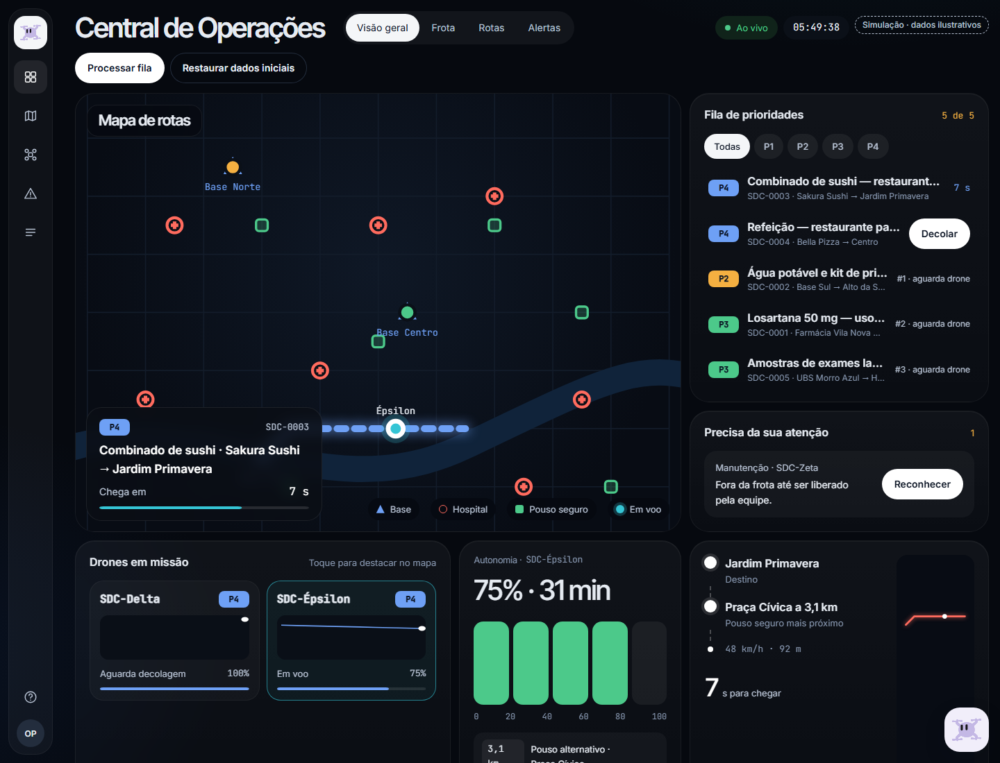
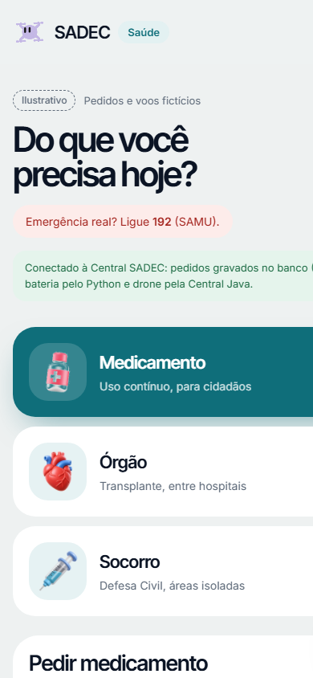

# SADEC — Sistema Autônomo de Drones de Cuidado e Entrega

**Global Solution 2026 · CitizenTech · Turma 1TDSPB · FIAP**

- Repositório: [github.com/Kauanzxd/Global_Solution-Site](https://github.com/Kauanzxd/Global_Solution-Site)
- Página de contato: [`contato.html`](contato.html) · publicação em serviço único: veja [Versão publicada (Railway)](#versão-publicada-railway)

Rede conceitual de drones que transporta órgãos, kits de emergência e medicamentos com prioridade sobre qualquer outra carga, e usa entregas comerciais para ajudar a sustentar a operação.

> **Projeto acadêmico.** Frota, pedidos, contas, lojas, rotas e telemetria são **demonstrativos e fictícios**. O SADEC não controla drones reais, não coleta dados pessoais ou médicos, não processa pagamentos e não tem parceria com hospitais, órgãos públicos ou plataformas de delivery. Em voo, a posição do drone é **estimada** pela decolagem e pela distância; não é localização real.

## Problema e objetivo

Órgãos para transplante têm janela de preservação curta e podem ficar presos no trânsito; enchentes isolam bairros; pessoas com mobilidade reduzida têm dificuldade para receber remédios de uso contínuo. O SADEC propõe um meio **complementar** de transporte para essas cargas, com regras rígidas de prioridade, reserva de bateria, pouso seguro e rastreabilidade. Entregas comerciais nos intervalos geram receita para as rotas de saúde.

## Como funciona

| Prioridade | Carga | Quem solicita |
|---|---|---|
| P1 · Órgãos | Órgãos e tecidos para transplante | Unidade de saúde com código emitido pela Central |
| P2 · Emergência | Água, remédios e kits para áreas isoladas | Governo (Defesa Civil, município) |
| P3 · Saúde | Remédios de uso contínuo, exames, insumos | Cidadãos, UBSs, farmácias |
| P4 · Comercial | Pedidos de lojas (delivery) | Clientes |

Regras aplicadas na Central:

1. Fila **P1 > P2 > P3 > P4**; empate pela ordem de chegada.
2. P1 e P2 podem tomar o drone de um pedido **comercial que ainda não decolou**; drone **em voo nunca é realocado**.
3. Toda entrega só decola se `ida e volta × 1,3 ≤ bateria` (30% de reserva).
4. Sem drone apto para P1 ou P2, o pedido segue por **outro meio de transporte**.
5. Decolagem manual pelo operador só para **P1** e para o **P2 que tomou o drone de um comercial**. Os demais saem sozinhos, com **5 min entre saídas da mesma filial**; o servidor aplica essas saídas mesmo sem nenhuma página aberta.
6. Pane: pouso na zona segura mais próxima (falha grave: paraquedas), depois **resgate, manutenção e liberação manual** do operador. Nenhum drone volta à frota sozinho.
7. Temperatura do órgão fora de 2–8 °C gera alerta; o recebimento registra responsável, destinatário, estado da carga e horário.
8. Demonstração em **tempo acelerado** (1 min da operação = 5 s reais). Distâncias, consumo, bateria e minutos exibidos continuam realistas.

Arquitetura:

```text
Navegador (HTML, CSS, JS puro)
   │  mesma origem
   ▼
scripts/producao.js ─ páginas do site + /api e /sadec (lista fechada de rotas) + /healthz
   │  rede interna 127.0.0.1
   ▼
Node-RED (API e chatbot) ─ ChatBot/node-red/lib/sadec-api.js
   ├─ Python  Python/sadec_integracao.py       distância e bateria necessária
   ├─ Java    CentralOperacao (IntegracaoCLI)  fila, escolha do drone, preempção, recuperação
   └─ SQLite  SADEC_Chatbot.db                 pedidos, drones, eventos, contas, recebimentos
```

Só a **CentralOperacao Java** decide o despacho. O Python calcula; o Node-RED orquestra; o SQLite é a única fonte de verdade. Sem a API, o site funciona no **modo simulação** (cidade-modelo no navegador, `js/operations.js`) e cada página indica o modo ativo.

## Funcionalidades

- **Central de Operações:** indicadores, mapa ao vivo, fila por prioridade, frota com bateria, alertas, histórico, códigos de órgão, nova solicitação e cenários de teste; alterna entre rede real e simulação.
- **SADEC Saúde:** pedidos P1 a P4 conforme o perfil da conta, pré-checagem de bateria e rastreamento.
- **SADEC Delivery:** lojas fictícias, sacola, comparação drone × entrega convencional, pedido P4 na Central e acompanhamento ao vivo.
- **Rastreamento:** busca por código, mapa, chegada prevista, bateria estimada, linha do tempo e registro de recebimento.
- **Contas:** cliente, unidade de saúde, governo e operador; senhas com hash scrypt; respostas 401 (sem conta) e 403 (perfil sem permissão).
- **Drone Bot:** assistente do site e chatbot do Node-RED (Webchat e widget), que consulta pedidos no mesmo banco. Usa a Groq quando há chave configurada; não implementa o IBM watsonx Assistant.

## Tecnologias

- **Front-end:** HTML5 semântico, CSS3 e JavaScript puro (namespace `window.SIDEC`, estado em `localStorage` na chave `sidec`). Sem frameworks.
- **Integração:** Node-RED 4, Python 3, Java 8+ (DDD), SQLite (`node:sqlite`).
- **Ferramentas:** Node.js 22.5+, `node:test`, ESLint, Docker e Railway.

## Páginas

| Página | Conteúdo |
|---|---|
| `index.html` | Apresentação, fila ao vivo, prioridades, segurança e impacto |
| `como-funciona.html` · `sobre.html` | Etapas de uma missão; problema, proposta e regulação |
| `central.html` | Central de Operações |
| `saude/index.html` | SADEC Saúde |
| `delivery/index.html` | SADEC Delivery |
| `rastreamento.html` | Rastreamento e recebimento |
| `orgaos.html` | Missão P1 demonstrativa |
| `entrar.html` | Login e cadastro |
| `drone-bot.html` | Drone Bot, o assistente do SADEC |
| `faq.html` · `contato.html` | Perguntas frequentes; formulário de contato com validação |
| `integrantes.html` | Equipe |

## Estrutura

```text
├── *.html, saude/, delivery/      páginas
├── css/, js/, assets/             estilos, scripts e imagens
├── ChatBot/
│   ├── fluxo-node-red-sadec.json  fluxo do Node-RED (API e chatbot)
│   ├── node-red/                  settings.js e lib/sadec-api.js
│   ├── migracoes/                 migrações do banco (com backup e transação)
│   └── SADEC_Chatbot.db           banco demonstrativo inicial
├── Java/SADEC/                    src (modelo e CentralOperacao) e test
├── Python/                        sadec.py, sadec_integracao.py e testes
├── scripts/                       serve.js (desenvolvimento) e producao.js (publicação)
├── tests/                         testes do site e da API
├── docs/capturas/                 capturas de tela
└── Dockerfile, railway.json       publicação
```

## Como executar localmente

Pré-requisitos: Node.js 22.5+, Python 3.10+ e JDK 8+.

```bash
npm install
cd ChatBot/node-red && npm install && cd ../..
npm run api      # API e chatbot em http://localhost:1880 (editor do Node-RED em /admin)
npm start        # site em http://localhost:5173 (outro terminal)
```

A API encontra Python e Java automaticamente e compila a parte Java se necessário; para fixar os caminhos, use `SADEC_PYTHON` e `SADEC_JAVA`. Só o site, sem API: `npm start` (modo simulação).

Testes:

```bash
npm test                                    # site e API
npm run lint
python Python/test_sadec_integracao.py      # Python
javac --release 8 -encoding UTF-8 -d Java/SADEC/out $(find Java/SADEC/src Java/SADEC/test -name "*.java")
java -cp Java/SADEC/out br.com.fiap.sadec.integracao.IntegracaoTeste
```

Para voltar o banco aos dados demonstrativos depois de testar: pare a API e rode `git checkout -- ChatBot/SADEC_Chatbot.db`.

## Versão publicada (Railway)

Um único serviço Docker serve o site e a API na mesma origem. O Node-RED escuta só em `127.0.0.1` e o editor fica desligado em produção; o público acessa apenas as páginas, as rotas da API e `/healthz`.

1. No Railway, crie um projeto a partir deste repositório; o `railway.json` usa o `Dockerfile`.
2. Adicione um **volume** montado em `/data` (o banco fica em `/data/SADEC_Chatbot.db`; na primeira inicialização o banco demonstrativo é copiado, e depois nunca é sobrescrito).
3. Gere um domínio público em *Settings → Networking*. A porta vem da variável `PORT` do Railway.
4. Variáveis opcionais: `GROQ_API_KEY` (IA do chatbot) e `TELEGRAM_BOT_TOKEN`. Sem elas, o chatbot usa o entendimento local por palavras-chave.

Para rodar a versão de produção sem Docker: `npm run producao` (com `SADEC_DATA_DIR` apontando para uma pasta gravável).

## Contas demonstrativas

Contas **fictícias**, só para a apresentação; não são contas de produção.

| Conta | Senha | Acesso |
|---|---|---|
| `cliente@sadec.demo` | `sadec2026` | Delivery e remédios (P3, P4) |
| `hospital@sadec.demo` | `sadec2026` | Unidade de saúde: órgão (P1, com código) e P3 |
| `governo@sadec.demo` | `sadec2026` | Socorro (P2) |
| `operador@sadec.demo` | `sadec2026` | Central: decolar, concluir, fila, códigos, liberação |
| `admin@sadec.demo` | `121365` | Operador com acesso a todas as áreas |

## Capturas de tela

| Central integrada | Rastreamento | SADEC Saúde |
|---|---|---|
|  |  |  |

| Início | Chatbot (widget do Node-RED) | Saúde no celular |
|---|---|---|
|  |  |  |

## Integrantes

| Foto | Nome | RM | Turma | Perfis |
|---|---|---|---|---|
|  | Kauan Gomes dos Santos | 574837 | 1TDSPB | [GitHub](https://github.com/Kauanzxd) · [LinkedIn](https://www.linkedin.com/in/kauan-gomes-dos-santos-94b02a430/) |
|  | Pablo Ackillys Anjos da Silva | 576881 | 1TDSPB | [GitHub](https://github.com/PabloAckillys) · [LinkedIn](https://www.linkedin.com/in/pabloackillys/) |
|  | Thomaz Rafael Krutman Neves da Rocha | 576834 | 1TDSPB | [GitHub](https://github.com/ThomazRocha) · [LinkedIn](https://www.linkedin.com/in/thomaz-rafael-krutman-neves-da-rocha-42aa7343a/) |
|  | Gustavo Almeida Rodrigues | 576939 | 1TDSPB | [GitHub](https://github.com/gtzall) · [LinkedIn](https://www.linkedin.com/in/gustavo-almeida-rodrigues) |
|  | Cláudio Augusto Silva de Assis | 576661 | 1TDSPB | [GitHub](https://github.com/claudiosilva06) · [LinkedIn](https://www.linkedin.com/in/claudio-assis-dev) |

## Contato

- **Formulário:** página [`contato.html`](contato.html), com validação em JavaScript (campos obrigatórios, formato do e-mail e mensagem de sucesso). É uma demonstração: nada é enviado.
- **Equipe:** pelos perfis do GitHub e do LinkedIn listados em [Integrantes](#integrantes).
- **Dúvidas e sugestões sobre o código:** abra uma *issue* no [repositório](https://github.com/Kauanzxd/Global_Solution-Site/issues).

## Fontes e links

- Unidades de saúde: nomes e endereços do CNES (dados públicos), usados só para localização no mapa.
- Mapas: © colaboradores do [OpenStreetMap](https://www.openstreetmap.org/copyright) (precisa de internet).
- Documentação Java: `Java/SADEC_Documentacao_Java.pdf` e `Java/Diagrama_de_Classes_UML.png`.
