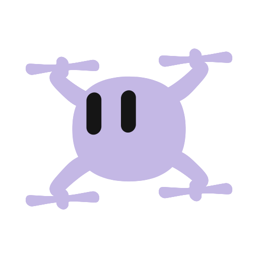
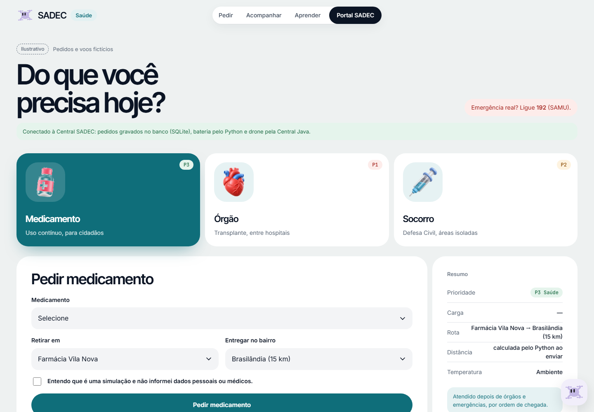
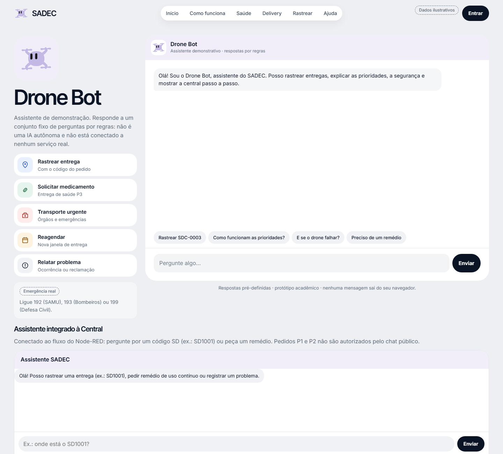

<div align="center">



# SADEC — Sistema Autônomo de Drones de Cuidado e Entrega

**Rotas aéreas para o que não pode esperar.**
Portal web de uma rede de drones que leva órgãos para transplante, kits de emergência e remédios na frente de qualquer outra carga, e usa entregas comerciais para sustentar a operação.


**FIAP · Global Solution 2026 · CitizenTech · Turma 1TDSPB**

[Repositório](https://github.com/Kauanzxd/Global_Solution-Site) ·
[Capturas de tela](#-capturas-de-tela) ·
[Como executar](#️-como-executar) ·
[Integrantes](#-integrantes) ·
[Contato](#-contato)

</div>

> **Projeto acadêmico.** Frota, pedidos, contas, lojas, rotas e telemetria são **demonstrativos e fictícios**. O SADEC não controla drones reais, não coleta dados pessoais ou médicos, não processa pagamentos e não tem parceria com hospitais, órgãos públicos ou plataformas de delivery. Em voo, a posição do drone é **estimada** pela decolagem e pela distância; não é localização real.

---

## 📌 Descrição

### O problema
Órgãos para transplante têm janela de preservação curta e podem ficar presos no trânsito; enchentes isolam bairros inteiros; pessoas com mobilidade reduzida têm dificuldade para receber remédios de uso contínuo.

### A solução
O SADEC propõe um meio **complementar** de transporte para essas cargas, com regras rígidas de prioridade, reserva de bateria, pouso seguro e rastreabilidade. Nos intervalos, entregas comerciais geram a receita que sustenta as rotas de saúde (**subsídio cruzado**).

Este repositório é o **portal do SADEC**: apresenta o projeto e simula a operação de ponta a ponta, do pedido do cidadão à Central de Operações que despacha os drones.

| Prioridade | Carga | Quem solicita |
|---|---|---|
| **P1** · Órgãos | Órgãos e tecidos para transplante | Unidade de saúde, com código emitido pela Central |
| **P2** · Emergência | Água, remédios e kits para áreas isoladas | Governo (Defesa Civil, município) |
| **P3** · Saúde | Remédios de uso contínuo, exames e insumos | Cidadãos, UBSs e farmácias |
| **P4** · Comercial | Pedidos de lojas (delivery) | Clientes |

<details>
<summary><b>Regras aplicadas pela Central de Operações</b></summary>

1. Fila **P1 > P2 > P3 > P4**; empate pela ordem de chegada.
2. P1 e P2 podem tomar o drone de um pedido **comercial que ainda não decolou**; drone **em voo nunca é realocado**.
3. Toda entrega só decola se `ida e volta × 1,3 ≤ bateria` (30% de reserva).
4. Sem drone apto para P1 ou P2, o pedido segue por **outro meio de transporte**.
5. Decolagem manual pelo operador só para **P1** e para o **P2 que tomou o drone de um comercial**. Os demais saem sozinhos, com **5 min entre saídas da mesma filial**; o servidor aplica essas saídas mesmo sem nenhuma página aberta.
6. Pane: pouso na zona segura mais próxima (falha grave: paraquedas), depois **resgate, manutenção e liberação manual** do operador. Nenhum drone volta à frota sozinho.
7. Temperatura do órgão fora de 2–8 °C gera alerta; o recebimento registra responsável, destinatário, estado da carga e horário.
8. Demonstração em **tempo acelerado** (1 min da operação = 5 s reais). Distâncias, consumo, bateria e minutos exibidos continuam realistas.

</details>

## ✨ Funcionalidades

| Área | O que faz |
|---|---|
| **Central de Operações** | Indicadores, mapa ao vivo, fila por prioridade, frota com bateria, alertas, histórico, códigos de órgão, nova solicitação e cenários de teste; alterna entre rede real e simulação |
| **SADEC Saúde** | Pedidos P1 a P4 conforme o perfil da conta, pré-checagem de bateria, simuladores e rastreamento |
| **SADEC Delivery** | Lojas fictícias, sacola, comparação drone × entrega convencional, pedido P4 na Central e acompanhamento ao vivo |
| **Rastreamento** | Busca por código, mapa de ruas, chegada prevista, bateria estimada, linha do tempo e registro de recebimento |
| **Missão P1 · Órgãos** | Passo a passo demonstrativo de um transporte de órgão, com bateria, temperatura e decisões da Central |
| **Contas** | Cliente, unidade de saúde, governo e operador; senhas com hash scrypt; respostas 401 (sem conta) e 403 (perfil sem permissão) |
| **Drone Bot** | Assistente do site e chatbot do Node-RED (Webchat e widget), que consulta os pedidos no mesmo banco |
| **Ajuda e Contato** | Perguntas frequentes em abas e acordeão; formulário de contato com validação e feedback visual |

## 🛠️ Tecnologias utilizadas

| Camada | Tecnologias |
|---|---|
| **Front-end** | **HTML5** semântico, **CSS3** (variáveis, Grid, Flexbox e Media Queries) e **JavaScript** puro, em arquivos externos. **Sem frameworks nem bibliotecas de interface** |
| **Mapas** | Mapa de ruas do OpenStreetMap desenhado com JavaScript próprio (`js/mapa-osm.js`), sem biblioteca |
| **Integração** | Node-RED 4 (API e chatbot), Python 3 (cálculo de rota e bateria), Java (regras da Central, DDD) e SQLite (`node:sqlite`) |
| **Versionamento** | **Git e GitHub**, com commits de todos os integrantes |
| **Qualidade e publicação** | Node.js 22.5+, testes com `node:test`, ESLint, Docker e Railway |

## ✅ Requisitos da disciplina: onde encontrar

| Requisito (Front-End Design Engineering) | Onde está no projeto |
|---|---|
| Páginas obrigatórias | `index.html`, `integrantes.html`, `sobre.html`, `faq.html` e `contato.html` |
| Páginas da solução (mínimo 2) | `como-funciona.html`, `central.html`, `saude/index.html`, `delivery/index.html`, `rastreamento.html`, `orgaos.html`, `drone-bot.html` e `entrar.html` |
| Menu mobile controlado por JavaScript | Botão hambúrguer em todas as páginas (`js/ui.js`) |
| Validação do formulário de contato | `contato.html` + `js/form-validation.js`: campos obrigatórios, formato do e-mail, mensagens por campo, destaque visual e mensagem de sucesso |
| Componentes interativos adicionais | Abas e acordeão (`faq.html`), simulador de subsídio cruzado (`index.html`), simuladores de temperatura e autonomia (`saude/`), sacola e cotação (`delivery/`), busca e mapa do rastreamento, Drone Bot |
| Responsividade | Media Queries em todos os arquivos de `css/`, testadas em 390 × 844, 768 × 1024 e 1440 × 900, sem rolagem horizontal |
| Acessibilidade básica | `alt` nas imagens, `label` em todos os campos, link "Pular para o conteúdo", `aria-*` no menu, nas abas e nos alertas |
| CSS e JS externos | Pastas `css/` e `js/`; nenhum atributo `style` inline e nenhum `<script>` embutido |

## 📁 Estrutura de pastas

```text
Global_Solution-Site/
├── index.html                 início: proposta, fila ao vivo, prioridades e impacto
├── como-funciona.html         as seis etapas de uma missão
├── sobre.html                 problema, objetivo e proposta da equipe
├── faq.html                   perguntas frequentes (abas e acordeão)
├── contato.html               formulário de contato com validação
├── integrantes.html           equipe: nome, RM, turma, foto, GitHub e LinkedIn
├── central.html               Central de Operações
├── rastreamento.html          rastreamento e registro de recebimento
├── orgaos.html                missão P1 demonstrativa
├── drone-bot.html             assistente do SADEC
├── entrar.html                login e cadastro
├── saude/  delivery/          SADEC Saúde e SADEC Delivery (index.html em cada pasta)
│
├── css/
│   ├── variables.css          paleta, tipografia e espaçamentos (tokens do design)
│   ├── base.css               reset e estilos gerais
│   ├── components.css         cabeçalho, menu, botões, cards, formulários e acordeão
│   ├── pages.css              páginas institucionais (início, sobre, ajuda, contato, integrantes)
│   └── central.css, control.css, saude.css, delivery.css, drone-bot.css   estilos de cada área
│
├── js/
│   ├── ui.js                  menu mobile, acordeão, abas e utilitários
│   ├── form-validation.js     validação do formulário de contato
│   ├── operations.js          motor da simulação: prioridade, autonomia, voo e contingência
│   ├── data.js, state.js      dados fictícios e estado compartilhado (localStorage)
│   ├── api.js                 cliente da API (rede real), com modo simulação de reserva
│   ├── mapa-osm.js            mapa de ruas do OpenStreetMap
│   └── home.js, central*.js, saude.js, delivery*.js, tracking.js, orgaos.js, entrar.js, chatbot.js
│
├── assets/                    ícones, imagens e fotos dos integrantes
├── docs/capturas/             capturas de tela usadas neste README
├── ChatBot/                   fluxo do Node-RED (API e chatbot), migrações e banco SQLite demonstrativo
├── Java/SADEC/                regras da Central em Java (modelo, CentralOperacao e testes)
├── Python/                    sadec.py, integração com o Node-RED e testes
├── scripts/                   serve.js (desenvolvimento) e producao.js (publicação)
├── tests/                     testes do site e da API
└── Dockerfile, railway.json   publicação em serviço único
```

<details>
<summary><b>Arquitetura da integração</b></summary>

```text
Navegador (HTML, CSS, JS puro)
   │  mesma origem
   ▼
scripts/producao.js ─ páginas do site + /api e /sadec (lista fechada de rotas) + /healthz
   │  rede interna 127.0.0.1
   ▼
Node-RED (API e chatbot) ─ ChatBot/node-red/lib/sadec-api.js
   ├─ Python  Python/sadec_integracao.py       distância e bateria necessária
   ├─ Java    CentralOperacao (IntegracaoCLI)  fila, escolha do drone, preempção, recuperação
   └─ SQLite  SADEC_Chatbot.db                 pedidos, drones, eventos, contas, recebimentos
```

Só a **CentralOperacao Java** decide o despacho. O Python calcula; o Node-RED orquestra; o SQLite é a única fonte de verdade. Sem a API, o site funciona no **modo simulação** (cidade-modelo no navegador, `js/operations.js`) e cada página indica o modo ativo.

</details>

## 📸 Capturas de tela

| Início | Central de Operações | Rastreamento |
|---|---|---|
|  |  |  |

| SADEC Saúde | Saúde no celular | Chatbot (widget do Node-RED) |
|---|---|---|
|  |  |  |

## ▶️ Como executar

**Só o site (modo simulação):** não precisa instalar nada além do Node.js.

```bash
npm start        # site em http://localhost:5173
```

**Site com a API (rede real):** pré-requisitos Node.js 22.5+, Python 3.10+ e JDK 8+.

```bash
npm install
cd ChatBot/node-red && npm install && cd ../..
npm run api      # API e chatbot em http://localhost:1880 (editor do Node-RED em /admin)
npm start        # site em http://localhost:5173 (outro terminal)
```

A API encontra Python e Java automaticamente e compila a parte Java se necessário; para fixar os caminhos, use `SADEC_PYTHON` e `SADEC_JAVA`.

<details>
<summary><b>Testes</b></summary>

```bash
npm test                                    # site e API
npm run lint
python Python/test_sadec_integracao.py      # Python
javac --release 8 -encoding UTF-8 -d Java/SADEC/out $(find Java/SADEC/src Java/SADEC/test -name "*.java")
java -cp Java/SADEC/out br.com.fiap.sadec.integracao.IntegracaoTeste
```

Para voltar o banco aos dados demonstrativos depois de testar: pare a API e rode `git checkout -- ChatBot/SADEC_Chatbot.db`.

</details>

<details>
<summary><b>Publicação (Railway)</b></summary>

Um único serviço Docker serve o site e a API na mesma origem. O Node-RED escuta só em `127.0.0.1` e o editor fica desligado em produção; o público acessa apenas as páginas, as rotas da API e `/healthz`.

1. No Railway, crie um projeto a partir deste repositório; o `railway.json` usa o `Dockerfile`.
2. Adicione um **volume** montado em `/data` (o banco fica em `/data/SADEC_Chatbot.db`; na primeira inicialização o banco demonstrativo é copiado, e depois nunca é sobrescrito).
3. Gere um domínio público em *Settings → Networking*. A porta vem da variável `PORT` do Railway.
4. Variáveis opcionais: `GROQ_API_KEY` (entendimento de linguagem do chatbot) e `TELEGRAM_BOT_TOKEN`. Sem elas, o chatbot usa o entendimento local por palavras-chave.

Para rodar a versão de produção sem Docker: `npm run producao` (com `SADEC_DATA_DIR` apontando para uma pasta gravável).

</details>

### Contas demonstrativas

Contas **fictícias**, só para a apresentação; não são contas de produção.

| Conta | Senha | Acesso |
|---|---|---|
| `cliente@sadec.demo` | `sadec2026` | Delivery e remédios (P3, P4) |
| `hospital@sadec.demo` | `sadec2026` | Unidade de saúde: órgão (P1, com código) e P3 |
| `governo@sadec.demo` | `sadec2026` | Socorro (P2) |
| `operador@sadec.demo` | `sadec2026` | Central: decolar, concluir, fila, códigos, liberação |
| `admin@sadec.demo` | `121365` | Operador com acesso a todas as áreas |

## 👥 Integrantes

| Foto | Nome completo | RM | Turma | GitHub | LinkedIn |
|---|---|---|---|---|---|
|  | Kauan Gomes dos Santos | 574837 | 1TDSPB | [Kauanzxd](https://github.com/Kauanzxd) | [LinkedIn](https://www.linkedin.com/in/kauan-gomes-dos-santos-94b02a430/) |
|  | Pablo Ackillys Anjos da Silva | 576881 | 1TDSPB | [PabloAckillys](https://github.com/PabloAckillys) | [LinkedIn](https://www.linkedin.com/in/pabloackillys/) |
|  | Thomaz Rafael Krutman Neves da Rocha | 576834 | 1TDSPB | [ThomazRocha](https://github.com/ThomazRocha) | [LinkedIn](https://www.linkedin.com/in/thomaz-rafael-krutman-neves-da-rocha-42aa7343a/) |
|  | Gustavo Almeida Rodrigues | 576939 | 1TDSPB | [gtzall](https://github.com/gtzall) | [LinkedIn](https://www.linkedin.com/in/gustavo-almeida-rodrigues) |
|  | Cláudio Augusto Silva de Assis | 576661 | 1TDSPB | [claudiosilva06](https://github.com/claudiosilva06) | [LinkedIn](https://www.linkedin.com/in/claudio-assis-dev) |

## 🔗 Repositório

Código-fonte e histórico completo: **[github.com/Kauanzxd/Global_Solution-Site](https://github.com/Kauanzxd/Global_Solution-Site)**

## 📬 Contato

- **Formulário:** página [`contato.html`](contato.html), com validação em JavaScript (campos obrigatórios, formato do e-mail e mensagem de sucesso). É uma demonstração: nada é enviado.
- **Equipe:** pelos perfis do GitHub e do LinkedIn listados em [Integrantes](#-integrantes).
- **Dúvidas e sugestões sobre o código:** abra uma *issue* no [repositório](https://github.com/Kauanzxd/Global_Solution-Site/issues).

## 📚 Fontes e créditos

- Unidades de saúde: nomes e endereços do CNES (dados públicos), usados só para localização no mapa.
- Mapas: © colaboradores do [OpenStreetMap](https://www.openstreetmap.org/copyright) (precisa de internet).
- Documentação Java: `Java/SADEC_Documentacao_Java.pdf` e `Java/Diagrama_de_Classes_UML.png`.
