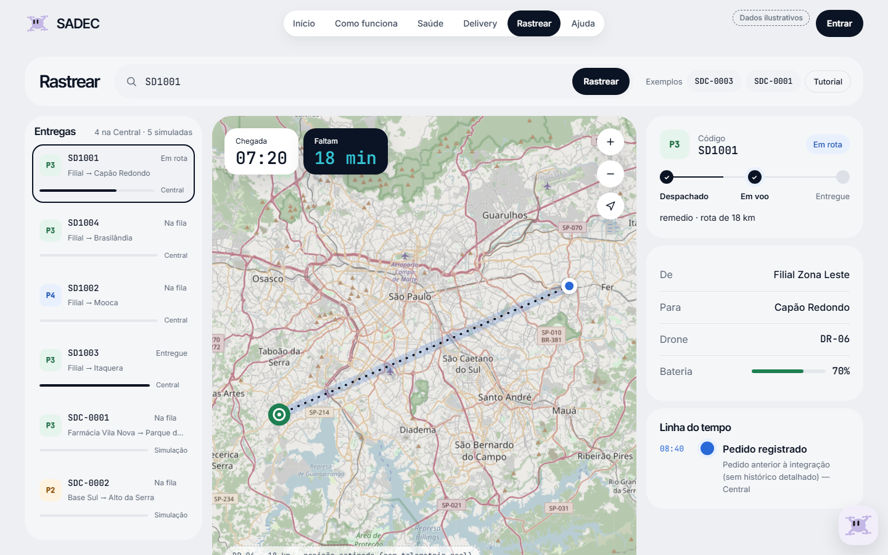
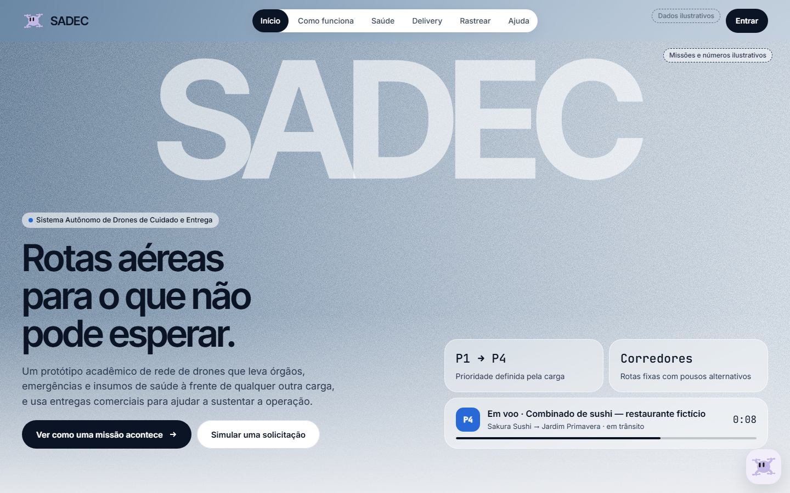

# SADEC — Sistema Autônomo de Drones de Cuidado e Entrega

> Rotas aéreas para o que não pode esperar.

Rede conceitual de drones que transporta órgãos, medicamentos e materiais emergenciais com prioridade sobre qualquer outra carga, e usa entregas comerciais para ajudar a sustentar a operação. Projeto da Global Solution FIAP 2026 · CitizenTech.

> **Aviso:** projeto acadêmico. Frota, rotas, mapas, telemetria, missões e Drone Bot são **simulações com dados fictícios**. O site não controla drones reais, não coleta dados pessoais ou médicos, não processa pagamentos e não possui parceria ou integração com hospitais, órgãos públicos ou plataformas de delivery.

## Problema
Órgãos para transplante têm janela de preservação limitada e podem ficar presos no trânsito. Enchentes e deslizamentos isolam bairros. Idosos, pessoas com mobilidade reduzida e moradores de regiões afastadas têm dificuldade para receber medicamentos de uso contínuo. Ao mesmo tempo, veículos de entrega lotam as ruas.

## Objetivo e proposta de valor
Oferecer um meio **complementar** de transporte para cargas críticas, com regras rígidas de prioridade, verificação de autonomia, zonas de pouso seguro e rastreabilidade. Entregas comerciais nos intervalos geram receita para as rotas de saúde (**subsídio cruzado**).

| Prioridade | Carga | Quem solicita |
|---|---|---|
| P1 · Órgãos | Órgãos e tecidos para transplante | Hospitais e Central de Transplantes |
| P2 · Emergência | Água, medicamentos e kits para áreas isoladas | Defesa Civil e prefeituras |
| P3 · Saúde | Medicamentos de uso contínuo e insumos | Cidadãos, UBSs e farmácias |
| P4 · Comercial | Entregas convencionais | Comércio local (parcerias potenciais) |

## Páginas
| Página | O que faz |
|---|---|
| `index.html` | Apresentação, fila da Central ao vivo, etapas de uma missão (abas), prioridades, linha do dia da frota, simulador de subsídio, segurança, impacto e ODS |
| `como-funciona.html` | Os seis passos de uma missão ilustrativa (P3) e as respostas para exceções |
| `sobre.html` | Descrição, problema, objetivo, proposta de valor, público, regulação (ANAC/DECEA, LGPD) e integração com as disciplinas |
| `central.html` | Central de Operações: mapa da frota com drones em movimento, fila por prioridade, frota, nova solicitação, cenários de teste e registro operacional |
| `rastreamento.html` | Mapa esquemático, etapas, telemetria simulada, demonstrações de pane e **registro de recebimento** |
| `orgaos.html` | Missão P1 demonstrativa: janela de preservação, corredor exclusivo, temperatura, reserva de bateria e cadeia de custódia |
| `saude/index.html` | **SADEC Saúde**: pedidos por perfil (cidadão P3, hospital P1 com pré-checagem de autonomia, operador P2), rastreamento médico, simuladores e tutorial |
| `delivery/index.html` | **SADEC Delivery**: restaurantes fictícios, sacola, comparação drone × entrega convencional, pedido P4 na mesma Central e acompanhamento do voo |
| `drone-bot.html` | Conversa com o Drone Bot e atalhos para as cinco intenções |
| `faq.html` | **Ajuda**: perguntas frequentes por assunto (abas + accordion) e formulário de contato validado em JavaScript, com mensagens de erro e de sucesso |
| `integrantes.html` | Nome, RM, turma, foto, GitHub e LinkedIn dos integrantes |
| `entrar.html` | Tela de acesso **demonstrativa** (perfil, senha, código de 6 dígitos, acesso rápido): nada é verificado, enviado ou guardado |

## Regras da Central (implementadas em `js/operations.js`)
1. Fila ordenada por prioridade: **P1 → P2 → P3 → P4**; empate pela ordem de chegada.
2. P1 e P2 podem antecipar uma entrega comercial **antes da decolagem**; entrega **em voo** nunca é realocada.
3. Órgão só decola se `consumo da rota × 1,3 ≤ bateria` (reserva de 30%). Demais cargas: 15% (ilustrativo).
4. A Central escolhe o drone **disponível** mais próximo da filial adequada, com carga e autonomia suficientes; se não houver, indica **transporte alternativo**.
5. Pane de motor ou bateria: pouso na **zona segura mais próxima da rota**. Falha grave: paraquedas, luzes e alerta sonoro. A ocorrência é registrada e o drone segue para **resgate e manutenção**; só volta à frota depois de liberado.
6. Temperatura fora de 2–8 °C: alerta à equipe médica.
7. Recebimento registra **responsável, horário, destinatário, identificação da carga e estado da entrega**.

## Integração com as disciplinas
- **Python:** registro de pedidos, fila de prioridades, autonomia, reserva de bateria, falhas e pouso seguro seguem as mesmas regras do motor `js/operations.js`.
- **Java (DDD):** Drone, Entrega, Filial, Rota, ZonaPouso, Hospital e TransporteOrgao aparecem como entidades da simulação (`js/data.js`).
- **Banco de Dados:** clientes, drones, filiais, entregas, rotas, zonas de pouso, hospitais, transporte de órgãos, leituras de sensores e parceiros.
- **IA e Chatbot:** intenções rastrear entrega, solicitar medicamento, transporte urgente, reagendar e relatar problemas; entidades de carga, prioridade, bairro, horário e hospital.

## Arquitetura do front-end
- HTML5 semântico, CSS3 externo e JavaScript puro em scripts clássicos sob o namespace `window.SIDEC` (sem frameworks nem bibliotecas).
- `operations.js` reúne funções puras testadas em Node; `state.js` compartilha o estado entre páginas via `localStorage` (chave `sidec`), por isso o projeto deve ser servido por HTTP.
- Nenhum `style=""`, `<style>`, `element.style` ou `innerHTML`: o DOM é criado com `textContent` e as mudanças visuais usam classes e atributos SVG.
- Identidade visual "Precisão suave": tokens em `css/variables.css` (Inter Tight, Inter e JetBrains Mono; prioridades sempre com cor e código) e um acento por área: azul no portal e no Delivery, painel escuro na Central e teal na Saúde.
- Movimento com propósito: revelação ao rolar, drones e rotas animados nos mapas, transições de estado e confirmações. Tudo respeita `prefers-reduced-motion` e os laços param com a aba oculta. A Saúde não tem animação de entrada.

```
├── index.html, como-funciona.html, sobre.html, central.html, rastreamento.html, orgaos.html
├── faq.html (Ajuda: FAQ + contato), integrantes.html, drone-bot.html, entrar.html
├── saude/index.html (SADEC Saúde)
├── delivery/index.html (SADEC Delivery)
├── css/   variables · base · components · pages · control · saude · delivery · drone-bot
├── js/    ui · operations · data · state · drone-avatar · chatbot · home · central · tracking
│          orgaos · entrar · saude · delivery-core · delivery · form-validation
├── assets/ icons · images (fundos, restaurantes e integrantes)
├── tests/ operations.test.js · delivery.test.js
└── scripts/serve.js (servidor estático de desenvolvimento, sem dependências)
```

## Tecnologias
- **Front-end:** HTML5, CSS3 e JavaScript (ES2022) puro, sem frameworks.
- **Integração:** Node-RED 4 (API e chatbot), Python 3 (cálculos), Java 8+ (regras de negócio, DDD), SQLite (banco).
- **Ferramentas:** Node.js (testes com `node:test`, `node:sqlite`), ESLint, Git e GitHub.

## Como executar
```bash
npm start
```
Abra `http://localhost:5173`. Sem Node, qualquer servidor estático na raiz funciona (ex.: Live Server do VS Code). Abrir o HTML direto (`file://`) exibe as páginas, mas o estado pode não ser compartilhado entre elas.

## Como testar
```bash
npm install
npm test
npm run lint
```
- `npm test`: 35 testes das regras da Central (prioridade, reserva de 30%, seleção, antecipação, voo protegido, transporte alternativo, pane, manutenção, temperatura, recebimento) e do Delivery (sacola, capacidade da frota, cotação, limite de peso, fases do acompanhamento).
- `npm run lint`: ESLint com zero warnings.
- Manual: na Central, use **Cenários de teste**; no Rastreamento, as **Demonstrações de segurança** e o **Registro de recebimento**.

## Integrantes
| Nome | RM | Turma |
|---|---|---|
| Kauan Gomes dos Santos | 574837 | 1TDSPB |
| Pablo Ackillys Anjos da Silva | 576881 | 1TDSPB |
| Thomaz Rafael Krutman Neves da Rocha | 576834 | 1TDSPB |
| Gustavo Almeida Rodrigues | 576939 | 1TDSPB |
| Cláudio Augusto Silva de Assis | 576661 | 1TDSPB |

## Demonstração integrada (Python + Java + Node-RED + SQLite)

O site funciona sozinho no **modo simulado** (motor `js/operations.js`, dados no navegador). Com a API ligada, Saúde, Rastreamento, Central e o assistente do Drone Bot passam a usar a **demonstração integrada**, em que o banco SQLite é a única fonte de verdade dos pedidos. Cada página mostra qual modo está ativo.

```
Site (HTML/CSS/JS puro) ──fetch──▶ Node-RED (API + chatbot) ──▶ núcleo ChatBot/node-red/lib/sadec-api.js
                                                                  ├─ Python  Python/sadec_integracao.py  → distância e bateria (funções do sadec.py)
                                                                  ├─ Java    IntegracaoCLI → CentralOperacao → fila, drone, preempção, recuperação
                                                                  └─ SQLite  ChatBot/SADEC_Chatbot.db → pedidos, drones, eventos, recebimentos
```

| Componente | Papel | Onde |
|---|---|---|
| Python | Cálculo e validação: `calcular_distancia`, `calcular_bateria_necessaria` (reserva de 30%), `prioridade_do_uso` e validações originais. Interface JSON por linha de comando; o menu de console continua igual. | `Python/sadec.py`, `Python/sadec_integracao.py` |
| Java | Regras operacionais (DDD): `registrarPedido` (fila P1→P4, empate por chegada), `atribuirEntrega` (autonomia ida e volta × fator, preempção só antes da decolagem), `acionarPousoEmergencia`, `verificarCondicaoCarga` e o ciclo resgate → manutenção → aguardando liberação → **liberação manual**. O `Main` original segue como demonstração de console. | `Java/SADEC/src` |
| Node-RED | API, orquestração e chatbot (Webchat e Telegram no mesmo fluxo). O chatbot não escolhe drone: usa o mesmo núcleo. | `ChatBot/fluxo-node-red-sadec.json`, `ChatBot/node-red/` |
| SQLite | Pedidos (código `SD1001`, `SD1002`…), drones, locais, histórico de eventos e recebimentos. | `ChatBot/SADEC_Chatbot.db`, migração em `ChatBot/migracoes/` |

### Regras garantidas na integração
- Só a **CentralOperacao Java** escolhe o drone (não há segundo motor de despacho; a função `escolher_drone()` do Python continua só no programa acadêmico).
- O pedido fica `atribuida` com o drone reservado e **só entra em voo na decolagem** (`POST /api/pedidos/:codigo/decolar`).
- Reserva do drone com `UPDATE` condicional dentro de transação: o mesmo drone não é despachado duas vezes.
- Autorização: **P1** só hospital ou Central de Transplantes; **P2** só Defesa Civil ou município. O **chatbot público não autoriza P1 nem P2**.
- Drone em pouso de emergência, manutenção ou aguardando liberação **nunca** é despachado; não há volta automática à frota.
- Recebimento grava responsável, destinatário, estado da carga e horário, e entra no histórico.

### Como executar a demonstração integrada
Pré-requisitos: Node.js 22.5+ (usa o `node:sqlite` nativo), Python 3.10+, JDK 8+ para compilar e Java 8+ para rodar, Node-RED 4 (`npm install -g node-red`).

```bash
# 1. nós do fluxo original (sqlite e Telegram) no diretório do Node-RED do projeto
cd ChatBot/node-red && npm install && cd ../..
# 2. (opcional) a API compila a parte Java sozinha ao iniciar se encontrar o javac; manualmente:
javac --release 8 -encoding UTF-8 -d Java/SADEC/out $(find Java/SADEC/src Java/SADEC/test -name "*.java")
# 3. subir a API (porta 1880; http://localhost:1880 abre o Webchat e o editor fica em /admin)
npm run api
# 4. em outro terminal, o site (porta 5173)
npm start
```

| Variável | Para que serve | Padrão |
|---|---|---|
| `SADEC_PYTHON` | executável do Python | detectado ao iniciar (PATH, `py`, instalações do Windows) |
| `SADEC_JAVA` | executável do Java | detectado ao iniciar (PATH, `JAVA_HOME`, `~/.jdks`) |
| `SADEC_DB` | caminho do banco | `ChatBot/SADEC_Chatbot.db` |
| `GROQ_API_KEY`, `TELEGRAM_BOT_TOKEN` | IA e Telegram do chatbot (opcionais). Sem a chave da Groq, o chatbot usa o entendimento local por palavras-chave (`ChatBot/node-red/lib/entendimento.js`) e continua respondendo, inclusive explicando quando o assunto foge do escopo. | vazias |
| `NODE_RED_CREDENTIAL_SECRET` | cifra credenciais salvas pelo editor | gerada pelo Node-RED |

Nenhuma chave fica no código, no fluxo ou no banco. A API escuta só em `127.0.0.1` e aceita CORS apenas de `http://localhost:5173`.

### Endpoints
| Método | Rota | O que faz |
|---|---|---|
| POST | `/api/pedidos` | Cria pedido: valida, Python calcula, Java decide, SQLite grava, evento registrado |
| GET | `/api/pedidos` · `/api/pedidos/:codigo` | Lista / consulta com histórico e recebimento |
| POST | `/api/pedidos/:codigo/decolar` · `/concluir` | Decolagem e conclusão da entrega |
| POST | `/api/pedidos/:codigo/recebimento` | Responsável, destinatário e estado da carga |
| POST | `/api/fila/processar` | Ordena a fila pela Java e despacha os pendentes |
| GET | `/api/drones` · `/api/locais` | Frota e locais da rede piloto |
| POST | `/api/drones/:codigo/recuperacao` | `concluir_resgate`, `concluir_manutencao` ou `liberar` |
| GET/POST | `/sadec` · `/sadec/mensagem` | Webchat original e mensagens do chatbot |
| GET | `/sadec/widget.js` · `/sadec/widget.css` | Widget incorporável (`<script src="http://localhost:1880/sadec/widget.js">`) |

Exemplo de pedido:
```json
POST /api/pedidos
{ "tipo_carga": "remedio", "destino": "Mooca", "solicitante": { "tipo": "farmacia", "nome": "Farmácia (fictícia)" } }
→ 201 { "ok": true, "dados": { "pedido": { "codigo": "SD1005", "status": "atribuida", "drone_codigo": "DR-01", ... },
        "calculo_python": { "distancia_km": 6, "bateria_necessaria_pct": 15.6, "reserva_pct": 30 }, "decisao_java": { ... } } }
```

### Banco de dados
`ChatBot/migracoes/migrar.py up|down` aplica ou desfaz a migração 001 (faz backup antes, roda em transação): novos estados de drone e de pedido, origem, distância, peso e solicitante no pedido, e as tabelas `tbl_evento` e `tbl_recebimento`. Para voltar aos dados demonstrativos depois de testar: pare a API e rode `git checkout -- ChatBot/SADEC_Chatbot.db`.

### Testes
| Comando | O que cobre |
|---|---|
| `npm test` | 42 testes do site + 8 testes de integração (pulados se Python/Java não estiverem configurados) |
| `python Python/test_sadec_integracao.py` | 13 testes: distância, bateria, reserva de 30%, limite exato, entrada inválida, CLI |
| `java -cp Java/SADEC/out br.com.fiap.sadec.integracao.IntegracaoTeste` | 19 testes: fila P1–P4, empate, preempção, comercial em voo, bateria, pane, resgate, manutenção, liberação |

### Capturas de tela (reais, com a API ligada)
| Central integrada | Rastreamento de um pedido SD | SADEC Saúde |
|---|---|---|
|  |  |  |

| Início | Assistente (widget do Node-RED) | Saúde no celular |
|---|---|---|
|  |  |  |

### Limitações e o que é simulado
- Frota, rotas, mapas, telemetria (bateria em voo, temperatura, vibração) e horários do mapa são **simulados**. Pedidos da API não transmitem posição em tempo real: o mapa e a telemetria aparecem só no modo simulado.
- Hospitais, UBS, lojas, drones e pedidos são **fictícios**. Não há parceria com hospitais, órgãos públicos ou plataformas de delivery.
- A escolha do perfil no SADEC Saúde e o login de `entrar.html` são **demonstrações**: não há autenticação real. A autorização de P1/P2 é aplicada pela API com base no tipo de solicitante informado.
- O Delivery continua no modo simulado (não grava pedidos na API).
- O chatbot usa a **Groq** (Whisper e LLM) quando há chave configurada. **Não** implementa IBM watsonx Assistant; a conformidade com esse requisito depende de validação com o professor.
- O programa de console Python guarda pedidos em listas na memória (não persistente) e tem a senha de emergência no próprio código, como na entrega da disciplina.
